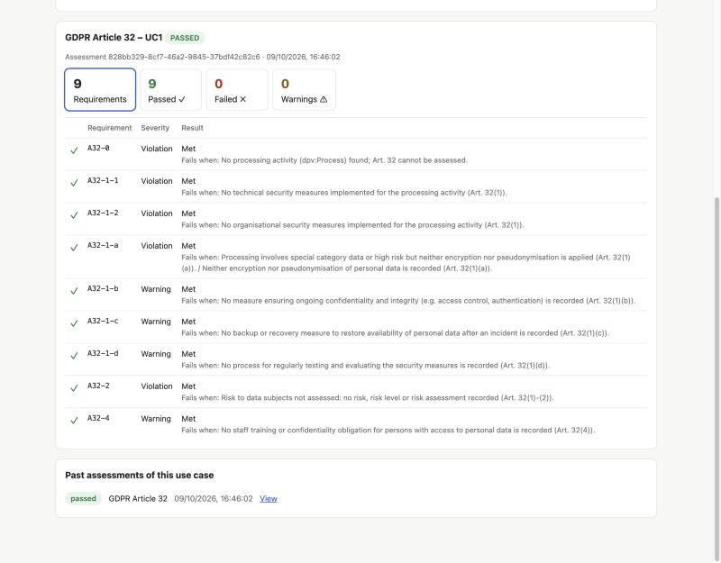
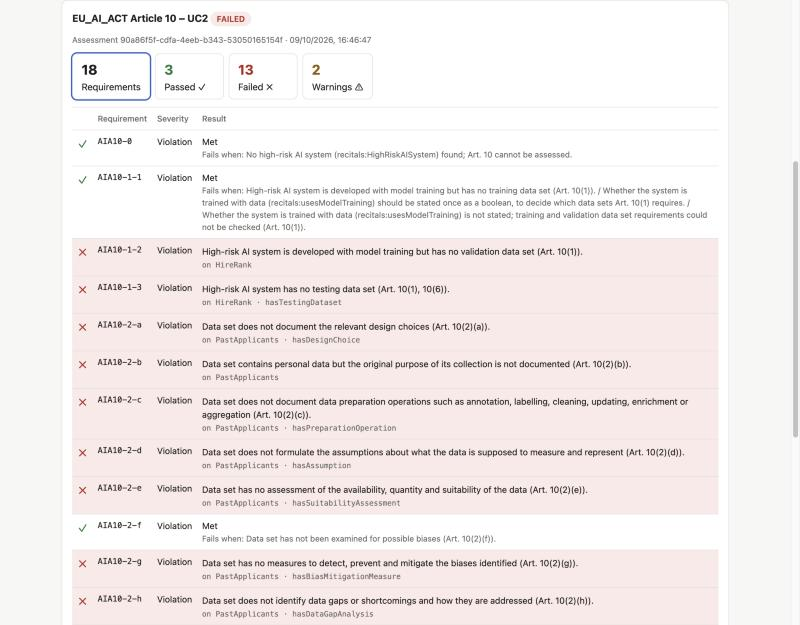

# RECITALS-compliance-manager

RECITALS is a compliance management system that validates RDF data using SHACL shapes and stores/queries data using an Apache Jena Fuseki triple store. The system is fully containerized and orchestrated using Docker Compose.

---

# System Overview

The system consists of four main components:

| Component | Port | Role |
|---|---|---|
| Apache Jena Fuseki | 3030 | RDF triple store; each use case's data lives in its own named graph |
| Input API | 8000 | creates use cases and stores uploaded RDF data |
| Compliance API | 8001 | runs the SHACL check for one law and article and stores the result |
| Status API | 8002 | returns the latest stored result for a use case, law and article |

All services communicate through a Docker internal network.

## Supported assessments

| Law | Article | What is checked | Shapes |
|---|---|---|---|
| GDPR | 30 | Records of processing activities | `compliance-api/shapes_gdpr30.ttl` |
| GDPR | 32 | Security of processing | `compliance-api/shapes_gdpr32.ttl` |
| NIS2 | 20 | Governance: management body approval, oversight and training | `compliance-api/shapes_nis2_20.ttl` |
| NIS2 | 21 | Cybersecurity risk-management measures (Art. 21(2)(a)-(j)) and supplier risk (Art. 21(3)) | `compliance-api/shapes_nis2_21.ttl` |
| EU_AI_ACT | 10 | Data and data governance of high-risk AI systems | `compliance-api/shapes_eu_act_10.ttl` |
| EU_AI_ACT | 11 | Technical documentation (Annex IV) of high-risk AI systems | `compliance-api/shapes_eu_act_11.ttl` |

Each finding carries a requirement id (for example `A32-1-a` or `AIA11-AIV-5`)
and an obligation: `mandatory` for what the law requires, `recommended` for
measures it only asks for "as appropriate" (in the shapes these are SHACL
`sh:Violation` and `sh:Warning`). A requirement whose findings are all
recommended is reported as `warning`. Any finding, including a recommended one,
makes the check `failed`.

The shapes use [DPV](https://w3id.org/dpv) 2.3 terms where they exist
(`dpv:Process`, `dpv:Encryption`, `dpv:RiskAssessment`, ...). The EU AI Act
shapes use DPV's `eu-aiact:`, `ai:` and `tech:` extensions
(`eu-aiact:HighRiskAISystem`, `ai:hasTrainingData`, `ai:BiasAssessment`,
`eu-aiact:TechnicalDocumentation`, ...). The project's `recitals:` namespace
(`http://example.org/recitals/`) is used only for concepts DPV does not cover,
such as `recitals:ManagementBody` (NIS2) or `recitals:hasDesignChoice`
(AI Act Art. 10(2)(a)). The header of each shapes file lists the terms it
expects.

---

# Requirements

## To run the system

- Docker Desktop (or Docker Engine) with Docker Compose. The four services run
  in containers, so nothing else needs to be installed.
- An internet connection for the first build, which downloads the Fuseki and
  Python images and the Python packages.
- A `.env` file with `FUSEKI_USER` and `FUSEKI_PASSWORD` (copy `.env.example`).
  Avoid spaces, `#`, `,` and `=` in the password.
- Free local ports 3030 (Fuseki), 8000 (Input API), 8001 (Compliance API) and
  8002 (Status API). All are bound to `127.0.0.1` only.
- A web browser for `/docs` on each API and `/ui` on the Compliance API.

## Components

| Component | Version |
|---|---|
| Python services | `python:3.12-slim` |
| FastAPI / Uvicorn | 0.143.0 / 0.54.0 |
| pySHACL / rdflib | 0.40.1 / 7.6.0 |
| requests / python-multipart | 2.34.2 / 0.0.32 |
| Triple store | Apache Jena Fuseki (`stain/jena-fuseki`), TDB2 storage in a Docker volume |

## Input data

RDF in Turtle (UTF-8) using [DPV](https://w3id.org/dpv) 2.3 terms, including its
`pd:`, `tech:`, `ai:` and `eu-aiact:` extensions, and `recitals:` terms where DPV
has none. The header of each shapes file lists the terms its article expects;
`examples/` has a compliant and a non-compliant file for every article.

## To run the tests

Python 3.10 or newer (3.12 recommended) and the packages in
`tests/requirements.txt`. Docker is not needed: the tests use an in-memory
stand-in for Fuseki. See [Tests](#tests).

---

# How to Run the Project

## 1. Install Docker

Install Docker Desktop:
https://www.docker.com/products/docker-desktop/

Verify installation:

```bash
docker --version
docker compose version
```

## 2. Clone the repository

```bash
git clone https://github.com/coolharsh55/RECITALS-compliance-manager.git
cd RECITALS-compliance-manager
```

## 3. Set the Fuseki password

```bash
cp .env.example .env
```

Edit `.env` and choose a password. It is used by Fuseki for its admin user
and by the three APIs to log in to it; `.env` is not committed. To change it
later, edit `.env` and run `docker compose up -d` again (the stored data is
kept).

All services are published on `127.0.0.1` only, so they are reachable from this
machine and not from the network. Within it, Fuseki's SPARQL queries are open,
while updates, uploads and the admin pages need the `.env` login. The APIs
(ports 8000-8002) have no login of their own; to make them reachable from other
machines, change their `ports` in `docker-compose.yml` and put a login in front
of them first.

## 4. Start the system

Open Docker Desktop, then run all services:

```bash
docker compose up --build -d
```

Each API has an interactive page at `/docs` where you can fill in the forms
and send requests from the browser instead of using curl:

- http://localhost:8000/docs (Input API)
- http://localhost:8001/docs (Compliance API)
- http://localhost:8002/docs (Status API)

A new use case ID is typed only when creating it (`POST /use-cases`). Every
other form offers the use cases that already exist as a dropdown; reload the
`/docs` page after creating one to see it. An ID that does not exist is
answered with `404 Use case not found`. Article numbers are a dropdown of the
supported articles too; an article that does not belong to the chosen law is
answered with `400` and the articles that do.

## 5. Open the web interface

http://localhost:8001/ui

Pick a use case, law and article, optionally add a Turtle file, and press
**Run check**. The page lists every requirement of the article with ✓ (met),
✗ (failed) or ⚠ (warning), the finding's message and the resource it concerns,
and counts for each. Click a count to show only those rows. Past assessments
of the use case are listed below and can be reopened. You can also create a
use case, or add a law to the selected one, from the page.

| Compliant data | Non-compliant data |
|---|---|
|  |  |

If the Input API is not at http://localhost:8000 as seen from the browser,
set `INPUT_API_PUBLIC_URL` on compliance-api and `UI_ORIGINS` (the page's
origin) on input-api.

## 6. Stop the system

```bash
docker compose down      # stop, keep the stored data
docker compose down -v   # stop and delete the Fuseki database
```

---

# Usage

An assessment takes three steps: create a use case for a law, upload RDF data
to it, and run the check for one article. All requests send form fields
(`-F`).

### 1. Create a use case

```bash
curl -X POST http://localhost:8000/use-cases \
  -F use_case_id=TALENTMATCH -F law=EU_AI_ACT -F label="TalentMatch CV screening"
```

- `use_case_id` is your choice: it starts with a letter, then letters, numbers,
  `_` or `-`, up to 80 characters (for example `TALENTMATCH` or `hr-screening-2026`).
  Other IDs are rejected with `422`, and an ID that already exists with `409`.
- `law` is `GDPR`, `NIS2` or `EU_AI_ACT`. To add another law to an existing use
  case:

  ```bash
  curl -X PATCH http://localhost:8000/use-cases/TALENTMATCH/laws -F law=GDPR
  ```

### 2. Upload RDF data (Turtle)

```bash
curl -X POST http://localhost:8000/input \
  -F use_case_id=TALENTMATCH -F file=@examples/eu_ai_act_10_compliant.ttl
```

Uploads add to the use case's data, and everything uploaded to a use case is
checked together. To start a use case over, clear its data:

```bash
source .env
curl -u "$FUSEKI_USER:$FUSEKI_PASSWORD" http://localhost:3030/dataset/update \
  --data-urlencode 'update=DROP GRAPH <http://example.org/recitals/graph/TALENTMATCH>'
```

### 3. Run the check

```bash
curl -X POST http://localhost:8001/check \
  -F use_case=TALENTMATCH -F law=EU_AI_ACT -F article=10
```

The response contains the `status` (`passed` or `failed`), an `assessment_id`,
`requirements` (every requirement of the article with `status` `passed`,
`failed` or `warning` and the findings behind it), a `summary` with the counts,
and the raw `findings`. `GET /assessments/<assessment_id>/report` returns the
same `requirements` for a stored assessment.

There is also one route per law, `POST /check/GDPR`, `/check/NIS2` and
`/check/EU_AI_ACT`, which take only `use_case` and `article`. They return the
same response; on `/docs` their article dropdown lists only that law's articles.

```bash
curl -X POST http://localhost:8001/check/GDPR -F use_case=UC1 -F article=32
```

### 4. Look up results

```bash
# Latest result for a use case, law and article
curl "http://localhost:8002/status?use_case_id=TALENTMATCH&law=EU_AI_ACT&article=10"

# All assessments of a use case, and one assessment's full report
curl http://localhost:8001/use-cases/TALENTMATCH/assessments
curl http://localhost:8001/assessments/<assessment_id>/report

# Articles available for a law
curl http://localhost:8001/laws/NIS2/articles
```

---

# Example data

`examples/` contains a compliant and a non-compliant data set for each
supported article: GDPR Art. 30 and 32, NIS2 Art. 20 and 21, and EU AI Act
Art. 10 and 11, all about employee data. The header of each example file lists the findings it should
produce. See [examples/README.md](examples/README.md).

---

# Tests

The tests run all three APIs against an in-memory stand-in for Fuseki. The
services run on Python 3.12 with the versions pinned in each service's
`requirements.txt`; `tests/requirements.txt` installs the same versions plus
the test tools, and needs Python 3.10 or newer:

```bash
python3.12 -m venv venv
venv/bin/pip install -r tests/requirements.txt
venv/bin/python -m pytest tests
```

Without a local Python 3.10+, run them in the same image the services use:

```bash
docker run --rm -v "$PWD":/src:ro python:3.12-slim sh -c \
  "cp -r /src /work && cd /work && pip install -q -r tests/requirements.txt && python -m pytest tests"
```

On Python 3.9 the tests also pass with unpinned packages and `pyshacl<0.30`
(newer pyshacl releases need a newer Python):

```bash
venv/bin/pip install pytest httpx fastapi uvicorn rdflib "pyshacl<0.30" requests python-multipart
```
